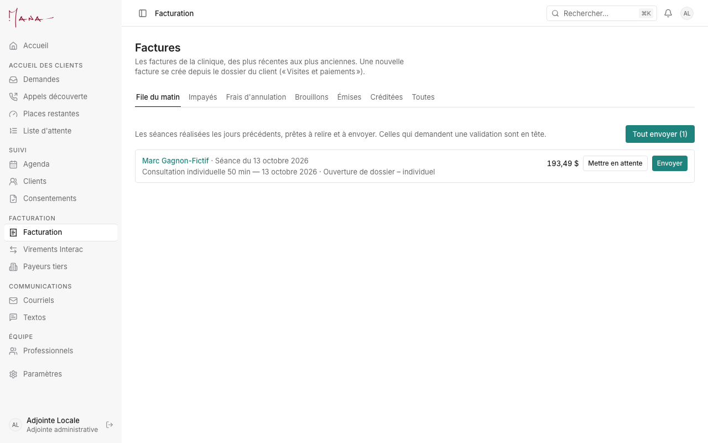
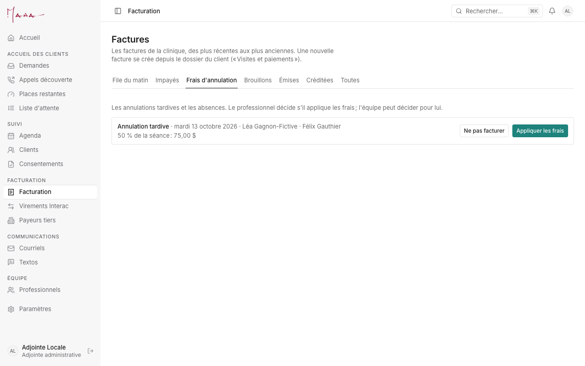

# Guide de l'adjointe administrative

**Pour :** l'adjointe qui teste l'app en novembre. **Vos scénarios d'essai :** [Essais de novembre, section 3](../runbooks/essais-novembre.md#3-adjointe). **Un problème :** [section 8](../runbooks/essais-novembre.md#8-signaler-un-problème).

> Pendant les essais, chaque client s'appelle « Test … » et porte **vos** coordonnées. Une facture finalisée prend un vrai numéro qui ne revient pas : faites-en peu et créditez-les après l'essai. Les images de ce guide viennent d'une base d'essai locale (noms fictifs).

Vous faites aussi tout ce que fait une conseillère (demandes, agenda, clients, courriels) : voir le [guide de la conseillère](conseillere.md). Ce guide couvre ce qui vous est propre.

## Votre journée, dans l'ordre

1. **Accueil.** La carte « Facturation à traiter » compte :
   - les brouillons prêts dans la file du matin, et ceux mis en attente ;
   - les factures impayées en retard ;
   - les virements Interac à rapprocher ;
   - les payeurs tiers à facturer ;
   - les frais d'annulation à décider pour un professionnel.

   Chaque chiffre ouvre la bonne liste.
2. **La file du matin** (Facturation, onglet « File du matin »). Les séances des jours précédents y attendent, prêtes à relire.
   - Celles qui demandent une validation (une entente particulière) sont en tête.
   - « Envoyer » finalise une facture : son numéro, son PDF et son courriel au payeur, retenu pendant les essais.
   - « Mettre en attente » la garde dans la file. « Tout envoyer (N) » envoie toutes les autres.
3. **Les paiements.** Ouvrez la facture, puis « Enregistrer un paiement » : le mode, le montant (au plus le solde), la date. Le reçu se crée tout seul.
4. **Les virements Interac** (menu « Virements Interac »). Recopiez l'avis reçu dans la boîte « administration », puis « Ajouter l'avis ». Choisissez la facture : « Rapprocher avec … » enregistre le paiement et son reçu.
5. **Les impayés** (onglet « Impayés »). Les factures en retard, la plus ancienne d'abord, avec le solde et la dernière relance. « Rendez-vous refusés » veut dire que le solde bloque une nouvelle réservation.
6. **Les frais d'annulation** (onglet « Frais d'annulation »). Les annulations tardives et les absences des 30 derniers jours.
   - Le professionnel décide dans « Mon agenda » ; vous pouvez décider pour lui.
   - « Appliquer les frais » crée un brouillon dans la file du matin. « Ne pas facturer » classe la ligne sans facture.
   - On peut aussi décider depuis le rendez-vous lui-même, onglet « Facturation ».
7. **Rembourser ou créditer.** Sur la facture : « Rembourser » un paiement (montant et raison), puis la note de crédit si la facture est annulée. Rien ne s'efface : une facture se crédite.
8. **Les payeurs tiers** (menu « Payeurs tiers »). Les séances à facturer à un PAE, à l'IVAC ou à un autre payeur, selon sa cadence.
9. **Les professionnels** (menu « Professionnels »). Révisez un profil « À réviser », vérifiez un document « À vérifier », préparez un contrat.

## Ce que veulent dire les statuts

| Statut d'une facture | Ce que ça veut dire |
|---|---|
| Brouillon | Pas encore envoyée : elle se modifie encore et n'a pas de numéro. |
| Émise | Envoyée, avec son numéro (AAAA-N) ; elle ne se modifie plus. |
| Créditée | Annulée par une note de crédit (NC-AAAA-N). |
| Non payée · Payée en partie · Payée | Où en est le paiement d'une facture émise. |

| Frais d'annulation | Ce que ça veut dire |
|---|---|
| À décider | Le professionnel (ou vous pour lui) n'a pas encore choisi. |
| Frais appliqués | Un brouillon de frais est dans la file du matin, ou déjà facturé. Le professionnel touche sa part une fois la facture payée. |
| Pas facturés | Personne ne paiera de frais pour cette annulation. |

| Virement Interac | Ce que ça veut dire |
|---|---|
| À rapprocher | L'avis est noté ; il reste à choisir sa facture. |
| Rapproché | Le paiement et son reçu sont enregistrés. |
| Ignoré | L'avis ne correspond à aucune facture (un doublon, par exemple). |

| Remboursement | Ce que ça veut dire |
|---|---|
| Remboursé | Enregistré (et fait chez Stripe pour une carte). |
| En attente de Stripe | Stripe n'a pas encore confirmé ; l'app réessaie seule. |
| Échec | Stripe a refusé : à refaire ou à régler autrement. |

| Profil d'un professionnel | Ce que ça veut dire |
|---|---|
| À inviter · Invité | Le dossier existe ; l'invitation n'est pas encore envoyée, ou elle l'est. |
| À réviser | Le professionnel a envoyé son profil : à relire. |
| En préparation | Profil approuvé ; contrat et documents en cours. |
| Actif · Inactif | Reçoit de nouveaux clients, ou plus. |
