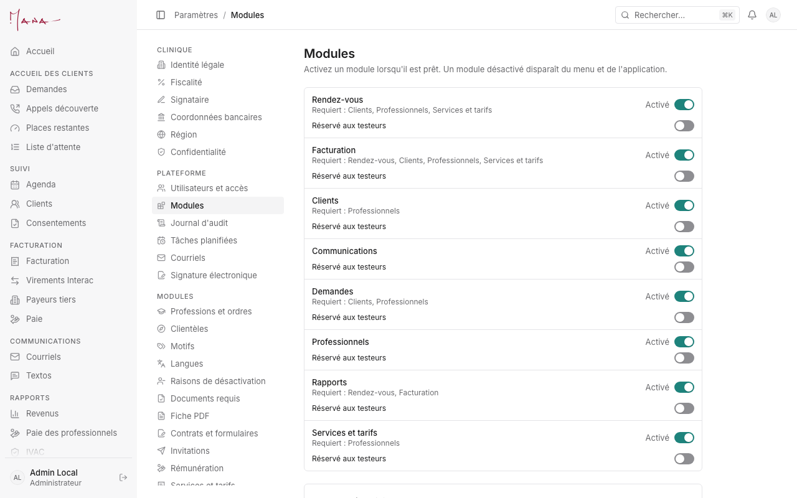
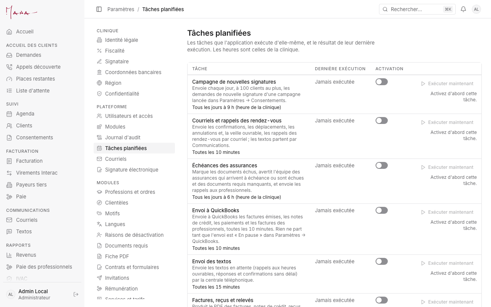

# Guide de l'administrateur

**Pour :** Jonathan, pendant les essais de novembre. **Vos scénarios d'essai :** [Essais de novembre, section 6](../runbooks/essais-novembre.md#6-administrateur-jonathan) ; ce qu'il faut préparer avant : [section 1](../runbooks/essais-novembre.md#1-avant-de-commencer-jonathan). **Un problème :** [section 8](../runbooks/essais-novembre.md#8-signaler-un-problème).

> Les essais se font sur la vraie base de la clinique, avec des clients « Test … ». Les images de ce guide viennent d'une base d'essai locale (noms fictifs).

L'administrateur voit tout ce que voient les autres rôles (guides [conseillère](conseillere.md), [adjointe](adjointe.md), [professionnel](professionnel.md)). Ce guide couvre les réglages.

## Avant chaque séance d'essais

1. **Paramètres → Modules.** Chaque module à essayer est activé avec « Réservé aux testeurs », et chaque personne qui teste est ajoutée comme testeuse. Tant qu'un module est réservé, les autres ne le voient pas et ses envois automatiques sont retenus.
2. **Paramètres → Utilisateurs et accès.** Un compte par personne, avec son rôle (Conseillère, Adjointe administrative, Professionnel, Administrateur). On ne prête pas un compte.
3. **Paramètres → Tâches planifiées.** Les tâches restent désactivées. Pour un essai : activez la tâche, cliquez « Exécuter maintenant » (elle tourne une fois), lisez le résultat, puis désactivez-la.

## Les réglages à vérifier, dans l'ordre

1. **Courriels** (Paramètres, « Plateforme »). Les modèles de courriels ; « M'envoyer un test » montre le courriel tel qu'il partirait.
2. **Courriels Gmail.** « Connecter une boîte » pour la boîte de la clinique. « Synchroniser » relit la boîte.
3. **Textos.**
   - La centrale téléphonique (Yeastar) et ses secrets.
   - Le texte de consentement et la réponse au retrait (le mot ARRÊT).
   - « Envoyer un texto de test » à votre cellulaire.
4. **IA.** La clé OpenAI, le modèle et le plafond mensuel. « Ce mois-ci » compte les demandes et leur coût. Une fois le plafond atteint, « Rédiger avec l'IA » s'arrête jusqu'au mois suivant.
5. **Signature électronique.** L'instance Documenso : « Tester la connexion », puis « Envoyer un document test ».
6. **Paiements en ligne.** Les clés Stripe et l'adresse du webhook. Le prélèvement du lendemain reste désactivé tant que la tâche planifiée l'est.
7. **QuickBooks.**
   - « Connecter QuickBooks », puis vérifiez les comptes suggérés (« Suggéré »).
   - « Correspondance des clients QuickBooks » : chaque client « À décider » se rattache ou s'ignore.
   - **L'envoi reste en pause** (« Démarrer l'envoi » seulement au go/no-go).
8. **Vidéoconférence.** Les professionnels connectent leur propre Zoom ; la page dit qui l'a fait.
9. **Facturation, Paie et Rémunération.** La numérotation, les relances, les règles de paie, les grilles de rémunération.

## Le suivi

- **Rapports** (menu « Rapports ») :
  - « Revenus » du mois par facture, service et paiement ;
  - « Annulations », « Indicateurs des demandes », « Consentements des clients », « IVAC » ;
  - « Paie des professionnels ».

  Chaque rapport s'exporte en CSV.
- **La paie** (Facturation → Paie). « Calculer le mois », vérifier, « Envoyer au professionnel ». Le professionnel valide et dépose sa facture. Vous « Marquer comme versée ». « Rouvrir » remet un sommaire « À valider ».
- **Paramètres → Journal d'audit.** Qui a fait quoi, et quand, en français. On y retrouve la création d'un dossier « Test … » ou une note de crédit.

## Ce que veulent dire les statuts

| Connexion (QuickBooks, Gmail, Zoom, Agenda Google) | Ce que ça veut dire |
|---|---|
| Connecté(e) | L'app peut lire ou envoyer. |
| À reconnecter | Le service a retiré ou laissé expirer l'accès : cliquez « Connecter » de nouveau. |
| Déconnecté(e) | Plus de lien ; rien ne passe. |

| Envoi à QuickBooks | Ce que ça veut dire |
|---|---|
| En pause | Rien ne part : c'est l'état pendant les essais. |
| En attente · Envoyé · En échec | Un document qui attend, qui est passé, ou que QuickBooks a refusé (le motif est écrit). |
| Correspondance : Rattaché · À décider · Sans correspondance · Ignoré | Le client a son client QuickBooks ; ou il faut choisir ; ou aucun n'a été trouvé ; ou il est mis de côté. |

| Tâche planifiée | Ce que ça veut dire |
|---|---|
| Activée · Désactivée | Elle tourne à son heure, ou pas du tout. |
| Résultat vert | La dernière exécution a réussi, avec son détail (par exemple « fees=0 reminders=0 »). |

| Module | Ce que ça veut dire |
|---|---|
| Désactivé | Personne ne le voit. |
| Réservé aux testeurs | Seules les testeuses le voient ; ses envois aux personnes hors de la clinique sont retenus. |
| Activé | Tout le monde, selon son rôle. Seulement à la bascule. |
