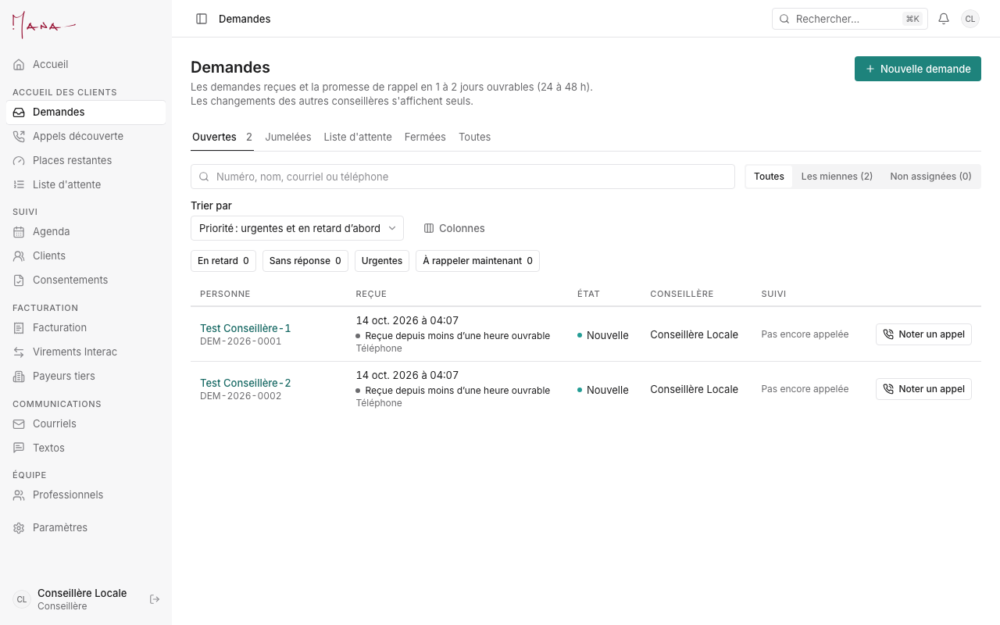
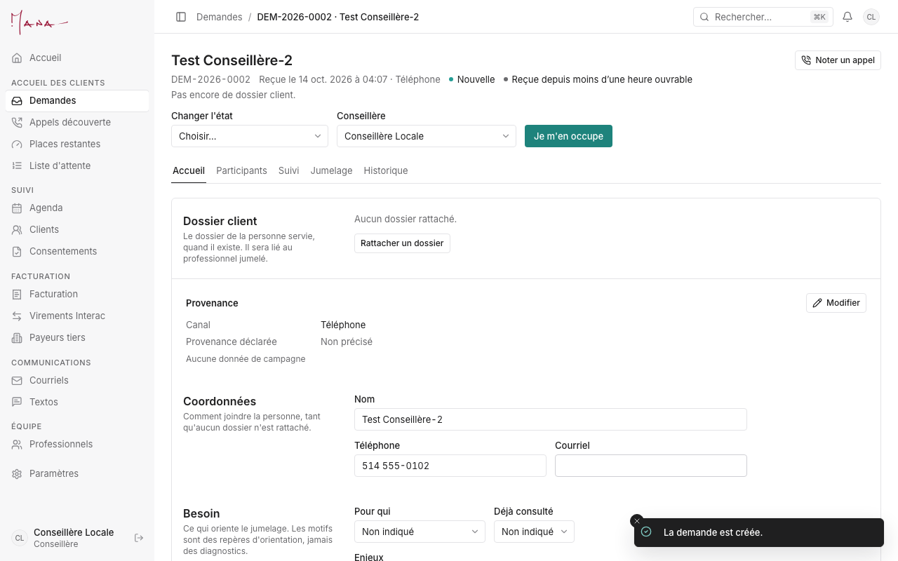

# Guide de la conseillère

**Pour :** les conseillères qui testent l'app en novembre. **Vos scénarios d'essai :** [Essais de novembre, section 4](../runbooks/essais-novembre.md#4-conseillère). **Un problème :** [section 8](../runbooks/essais-novembre.md#8-signaler-un-problème).

> Pendant les essais, chaque client s'appelle « Test … » et porte **vos** coordonnées. Jamais de vraie information clinique : un motif est une étiquette, jamais un diagnostic. Les images de ce guide viennent d'une base d'essai locale (noms fictifs).

## Votre journée, dans l'ordre

1. **Accueil.** Ce qui demande votre attention s'y affiche : les demandes à traiter, la facturation en attente. Chaque chiffre est un lien vers la liste concernée. « Rien ne demande votre attention » veut dire que tout est à jour.
2. **Demandes** (menu, « Accueil des clients »). L'onglet « Ouvertes » montre d'abord les urgentes, puis les demandes en retard, puis les plus anciennes.
   - En haut : « Les miennes » et « Non assignées ».
   - Les filtres « En retard », « Sans réponse », « Urgentes » et « À rappeler maintenant » donnent votre liste d'appels.
   - Ouvrez une demande, puis « Je m'en occupe » pour la prendre.
3. **Un appel reçu ou donné.** Cliquez « Noter un appel », sur la ligne de la liste ou en haut de la demande : le résultat (répondu, sans réponse…) et le prochain essai.
4. **Une personne au téléphone.** Cliquez « Nouvelle demande ». Entrez son prénom (son nom si elle le donne), son téléphone ou son courriel, et « Reçue par ».
   - Si la clinique la connaît déjà, « Dossiers existants » s'affiche sous les champs : le numéro du dossier, le nom, l'année de naissance et ce qui correspond (« Même téléphone (…4567) »). Cliquez « Utiliser ce dossier » : la demande sera créée déjà rattachée à ce dossier. « Ne pas rattacher » annule ce choix.
   - « Une demande est déjà ouverte pour cette personne » : ouvrez-la plutôt que d'en créer une autre, sauf si l'appel est pour quelqu'un d'autre de la famille.
   - Cliquez « Créer la demande » : la demande s'ouvre sur son onglet « Accueil ».
5. **Remplir l'accueil** (onglet « Accueil »), puis enregistrer :
   - « Rattacher un dossier » : le dossier de la personne qui fait la demande (celle qu'on rappelle). Une fois le dossier rattaché, ses coordonnées remplacent celles de la demande ;
   - si la demande est pour quelqu'un d'autre (un enfant, un couple, une famille), ajoutez ces personnes dans l'onglet « Participants » : le jumelage lit l'âge du participant principal ;
   - « Clientèle » reste sur « Automatique » : l'app la déduit des participants. Choisissez-en une seulement si la personne cherche une clientèle précise (accompagnement parental, athlètes…) ;
   - les motifs, écrits en entier, par catégorie ;
   - la langue, le mode (vidéo ou téléphone), les disponibilités, le payeur.
6. **Planifier l'appel découverte.** Dans l'onglet « Suivi », ajoutez une tâche « Appel découverte ». Le jour venu, elle paraît dans « Appels découverte » (Aujourd'hui, Demain, 7 prochains jours).
7. **Jumeler.**
   - L'onglet « Jumelage » montre les professionnels suggérés pour cette demande.
   - Dans « Suivi », cliquez « Proposer un professionnel » : le professionnel, le service, le mode, puis 1 à 3 de ses plages libres. Cliquez « Envoyer la proposition ».
   - La personne choisit une plage par le lien reçu. Si tout s'est réglé au téléphone, choisissez plutôt « Passer à « Jumelée » » dans « Changer l'état », en haut de la demande, et nommez le professionnel.
8. **Pas de place pour l'instant.** « Inscrire sur la liste d'attente », depuis la demande. « Places restantes » montre qui peut encore recevoir des clients.
9. **Prendre ou déplacer un rendez-vous.** Dans l'**Agenda**, cliquez sur une plage libre : le professionnel, le service, la date, l'heure, le mode et le client. Pour déplacer un rendez-vous, glissez-le. Pour l'annuler, ouvrez-le : l'app demande une raison.
10. **Courriels et Textos** (menu, « Communications »).
    - Répondez depuis la boîte de la clinique. « Rédiger avec l'IA » propose un texte que vous relisez.
    - Un fil se rattache au dossier du client.
    - Un texto ne part qu'avec le consentement du client.

## Ce que veulent dire les statuts

| Statut d'une demande | Ce que ça veut dire |
|---|---|
| Nouvelle | Reçue, personne ne l'a encore traitée. La promesse de rappel (1 à 2 jours ouvrables) court. |
| En évaluation | Une conseillère s'en occupe : appels, accueil, appel découverte. |
| Acceptée | La clinique peut aider : il reste à trouver le professionnel. |
| Proposée | Une proposition est envoyée ; la personne a 48 h pour choisir une plage. Sans réponse, la demande revient à « Acceptée » (ou à la liste d'attente). |
| Jumelée | Le premier rendez-vous est pris avec un professionnel. |
| Liste d'attente | La personne attend une place (onglet « Liste d'attente »). |
| Fermée | Terminée, avec une raison (référée ailleurs, sans réponse, autre…). |

| Statut d'un rendez-vous | Ce que ça veut dire |
|---|---|
| En attente d'acceptation | Une plage retenue pour une proposition, pas encore choisie. |
| Réservé | Pris ; la confirmation part au client (retenue pendant les essais). |
| Confirmé par le client | Le client a confirmé sa présence. |
| Terminé | Le rendez-vous a eu lieu. Pour un rendez-vous passé, « À indiquer » demande si la personne était présente ou absente. |
| Annulé | Annulé, avec une raison. « Annulation tardive » s'ajoute quand c'est trop tard selon la politique du service. |

**Les consentements d'un participant :** « signé », « à faire signer », « envoyé, pas encore signé », « à signer de nouveau » (une nouvelle version du texte) ou « signature en retard ». Ils ne bloquent ni le jumelage ni la proposition. On les envoie depuis le dossier du client.

## Ce que vous ne faites pas

Les factures, les frais d'annulation et la paie sont le travail de l'adjointe. Vous les voyez, sans pouvoir les modifier. Pour un frais d'annulation « À décider », c'est le professionnel qui décide (ou l'adjointe pour lui).
