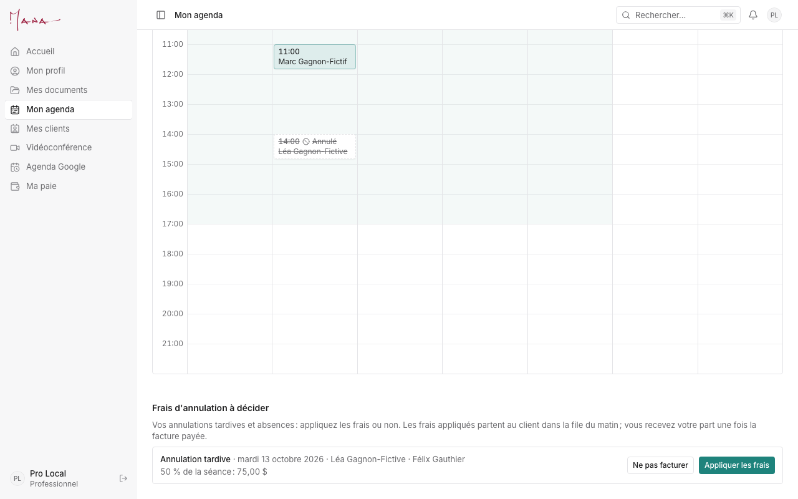
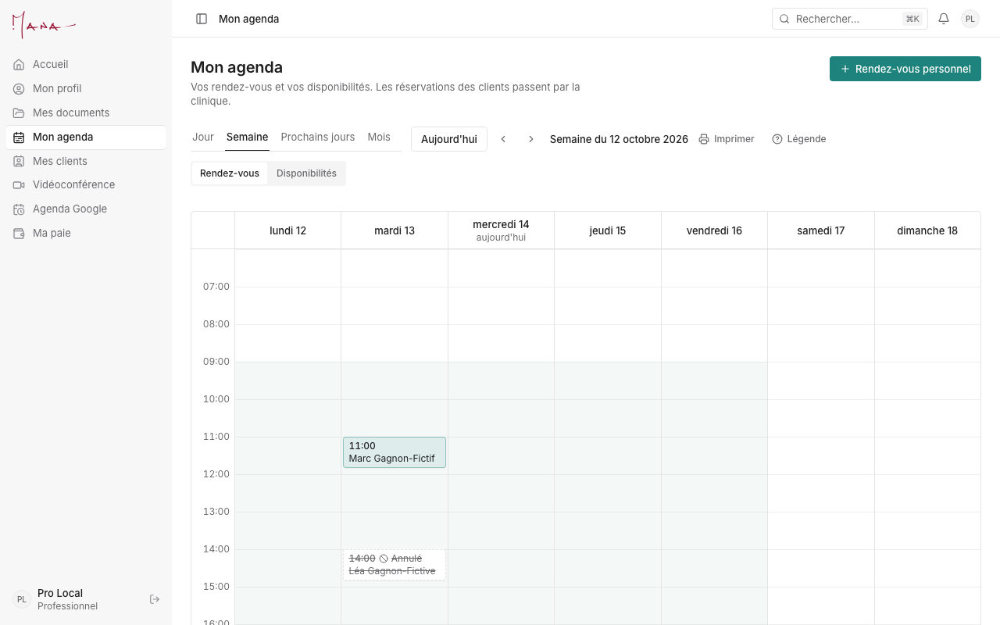
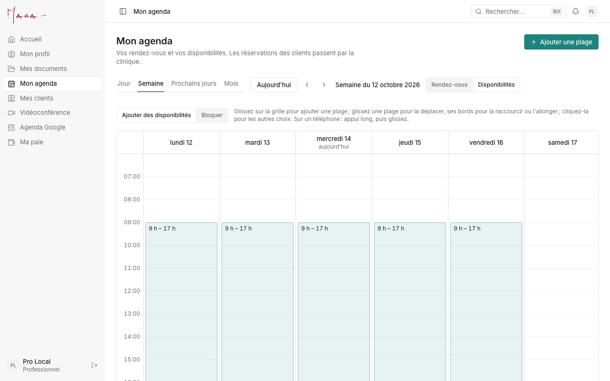

# Guide du professionnel

**Pour :** les professionnels qui testent l'app en novembre. **Vos scénarios d'essai :** [Essais de novembre, section 5](../runbooks/essais-novembre.md#5-professionnel). **Un problème :** [section 8](../runbooks/essais-novembre.md#8-signaler-un-problème).

> Pendant les essais, servez-vous du professionnel « test » ou de votre propre agenda, avec des clients « Test … ». Les notes cliniques restent hors de l'app. Les images de ce guide viennent d'une base d'essai locale (noms fictifs).

Votre menu ne montre que votre espace : Accueil, Mon profil, Mes documents, Mon agenda, Mes clients, Vidéoconférence, Agenda Google, Ma paie. Les réservations de vos clients passent par la clinique.

## Votre journée, dans l'ordre

1. **Accueil.** Ce qui vous attend s'y affiche : un profil à compléter, une mise à jour demandée par la clinique, des frais d'annulation à décider. Chaque ligne est un lien.
2. **Mon agenda**, vue « Rendez-vous ». Votre semaine (Jour, Semaine, Prochains jours, Mois). Cliquez un rendez-vous pour l'ouvrir : le client, le service, le lien vidéo et « Démarrer ».
3. **Après un rendez-vous.** Si la présence montre « À indiquer », choisissez « Présent » ou « Absent ».
   - Un rendez-vous où tout le monde est absent ne passe pas à « Terminé » : il attend la décision sur les frais.
4. **Vos frais d'annulation** (sous l'agenda, « Frais d'annulation à décider »). Pour chaque annulation tardive ou absence :
   - « Appliquer les frais » : la facture part au client dans la file du matin ;
   - « Ne pas facturer » : aucun frais.

   Vous recevez votre part une fois la facture payée. L'adjointe peut décider pour vous.

   
5. **Vos disponibilités** (Mon agenda, vue « Disponibilités »).
   - Glissez sur la grille pour ajouter une plage. Glissez une plage pour la déplacer, ou ses bords pour la raccourcir.
   - Cliquez une plage pour les autres choix (seulement cette semaine, vacances…).
   - Si des rendez-vous sortent de vos disponibilités, l'app vous avertit avant.
6. **Un rendez-vous personnel** (« Rendez-vous personnel », en haut de Mon agenda). Le dentiste, une formation : l'équipe voit « Occupé », jamais le titre.
7. **Mes clients.** Les dossiers des clients qui vous sont jumelés.
8. **Vidéoconférence.** Connectez votre Zoom (« Connecter mon Zoom ») : chaque rendez-vous vidéo a alors sa propre réunion. Sinon, entrez votre lien fixe (Google Meet, Teams…).
9. **Agenda Google** (facultatif). « Connecter mon agenda Google » : vos moments occupés paraissent « Occupé » dans l'agenda de la clinique, jamais le titre ni le lieu.
10. **Mon profil et Mes documents.** « Mettre mon profil à jour » choisit les sections à revoir ; la clinique révise avant que ça change. Vos documents (assurance, permis) se déposent dans « Mes documents ».
11. **Ma paie**, une fois par mois.
    - Le sommaire du mois paraît au début du mois suivant, une fois vérifié par l'administration.
    - Vérifiez-le, puis « Valider le sommaire », ou « Signaler une correction ».
    - Ajoutez ensuite votre facture : « Téléverser la facture », ou « Générer la facture ».

## Ce que veulent dire les statuts

| Statut d'un rendez-vous | Ce que ça veut dire |
|---|---|
| En attente d'acceptation | Une plage proposée à une personne, qui n'a pas encore choisi. |
| Réservé | Pris par la clinique. |
| Confirmé par le client | Le client a confirmé sa présence. |
| Terminé | Le rendez-vous a eu lieu. |
| Annulé · Annulation tardive | Annulé ; « tardive » quand c'est trop tard selon la politique du service (des frais sont alors possibles). |

| Présence | Ce que ça veut dire |
|---|---|
| Sera présent | Avant le rendez-vous : la personne est attendue. |
| À indiquer | Le rendez-vous est passé : dites si la personne était là. |
| Présent · Absent | Ce que vous avez indiqué. Une absence peut mener à des frais, que vous décidez. |

| Frais d'annulation | Ce que ça veut dire |
|---|---|
| À décider | En attente de votre choix. |
| Frais appliqués | La facture de frais part au client ; votre part suit son paiement. |
| Pas facturés | Aucun frais pour cette annulation. |

| Sommaire de paie | Ce que ça veut dire |
|---|---|
| Brouillon | L'administration le prépare ; vous ne le voyez pas encore. |
| À valider | Envoyé : à vérifier, puis à valider. |
| Correction demandée | Vous avez signalé une erreur ; l'administration corrige. |
| Validée | Vous avez confirmé le total ; ajoutez votre facture. |
| Versée | Le paiement est fait. |
